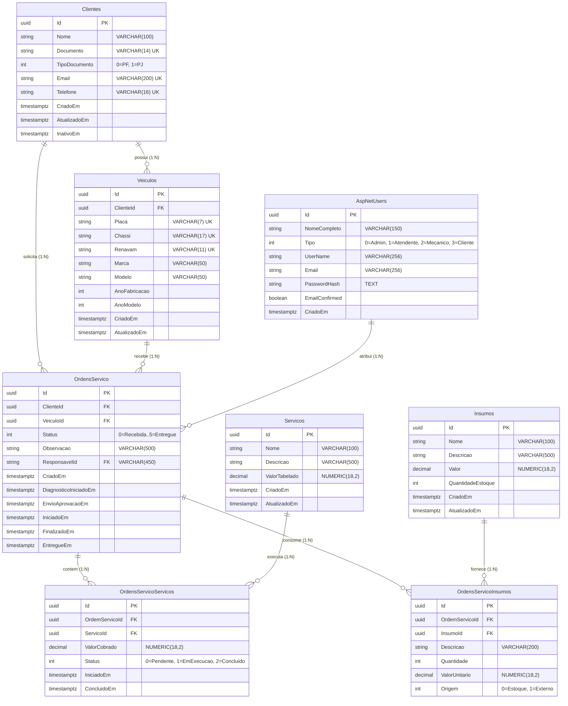

# 🗄️ Modelagem de Banco de Dados & Arquitetura Relacional — AutoReparos

> **SGBD:** AWS RDS PostgreSQL 16  
> **ORM / Controle de Migrações:** Entity Framework Core (EF Core Migrations)  
> **Padrão Arquitetural:** Modelo Relacional Normalizado (3NF) com Integridade Referencial Estrita e Transações ACID  

---

> [!IMPORTANT]
> ### Aviso Arquitetural — Fonte da Verdade e Gestão de Schema
> O **Entity Framework Core (EF Core Migrations)**, localizado no repositório `AutoReparos.App` (projeto `AutoReparos.Infra`), é a **ÚNICA FONTE DA VERDADE** para a modelagem, versionamento e evolução estrutural do banco de dados da aplicação.
> 
> Os scripts SQL presentes no diretório `scripts/` (`01_schema_init.sql` e `02_indexes_and_constraints.sql`) têm finalidade estritamente **DOCUMENTAL**, de auditoria técnica e referência DDL.
> 
> **Classificação de Risco: Baixo (Não Zero)**  
> Manter scripts SQL DDL manuais em paralelo ao EF Core apresenta risco baixo de divergência cadastral (*schema drift*) se houver atualizações na aplicação sem a correspondente atualização dos scripts documentais. Por esse motivo, em pipelines automatizados de CI/CD e ambientes de produção, as migrações devem ser executadas exclusivamente através das ferramentas do EF Core.

---

## 📌 1. Justificativa Formal da Escolha do PostgreSQL 16

O **PostgreSQL 16** foi selecionado como o SGBD principal da plataforma AutoReparos com base em 4 pilares técnicos fundamentais:

1. **Garantia de Consistência ACID Estrita:**  
   As operações da oficina mecânica envolvem transações financeiras e operacionais críticas, como aprovação de orçamentos, reserva e consumo de insumos/peças e transição de estados do fluxo Kanban. O isolamento transacional (*Read Committed / Repeatable Read*) do PostgreSQL impede *race conditions* e inconsistências de estoque.

2. **Alta Performance e Índices Especializados:**  
   Suporte robusto a índices B-Tree compostos e índices parciais. Permite busca em tempo de sub-milissegundos por CPF (`IX_Clientes_Documento`) e Placa (`IX_Veiculos_Placa`), essenciais para a performance da Lambda Serverless de autenticação de clientes e consultas públicas.

3. **Escalabilidade Gerenciada na AWS (Amazon RDS):**  
   Integração com recursos nativos da AWS: *Storage Autoscaling*, backups automatizados contínuos com Point-In-Time Recovery (PITR), Multi-AZ para alta disponibilidade e criptografia em repouso com AWS KMS.

4. **Compatibilidade com o Ecossistema .NET:**  
   Integração nativa com o provedor `Npgsql.EntityFrameworkCore.PostgreSQL`, permitindo mapeamento direto de tipos avançados (como `UUID v4` nativo e `timestamptz`).

---

## 📊 2. Diagrama Entidade-Relacionamento (ER)



---

## 🔗 3. Detalhamento dos Relacionamentos e Integridade Referencial

### A. `Clientes` ➔ `Veiculos` (1 : N)
- Um cliente pode possuir múltiplos veículos registrados.
- Regra de deleção: `ON DELETE RESTRICT`. A exclusão de um cliente só é permitida se ele não possuir histórico de ordens de serviço ou veículos ativos no pátio.

### B. `OrdensServico` (Entidade Central de Fato)
- Cada ordem de serviço está obrigatoriamente vinculada a um `ClienteId` e a um `VeiculoId`.
- Regra de deleção: `ON DELETE RESTRICT` em ambas as chaves para preservar o histórico contábil e técnico da oficina.

### C. `OrdensServicoServicos` e `OrdensServicoInsumos` (Associativas N : N)
- Representam os itens de mão de obra e insumos associados à ordem.
- Regra de deleção: `ON DELETE CASCADE` na relação com `OrdensServico` (se uma ordem for excluída, seus itens associados são removidos).
- Regra de deleção: `ON DELETE RESTRICT` nas relações com `Servicos` e `Insumos` (impede exclusão de itens de catálogo referenciados em ordens de serviço existentes).
- **Valores Congelados:** Os campos `ValorCobrado` e `ValorUnitario` registram o preço acordado no momento da aprovação, garantindo que alterações posteriores no catálogo não afetem orçamentos históricos.

---

## ⚡ 4. Estratégia de Indexação e Performance

| Tabela | Nome do Índice | Tipo | Colunas Indexadas | Justificativa Técnica |
| :--- | :--- | :--- | :--- | :--- |
| `Clientes` | `IX_Clientes_Documento` | B-Tree (Único) | `Documento` | Busca instantânea (< 5ms) por CPF na Lambda Serverless de autenticação. |
| `Clientes` | `IX_Clientes_Email` | B-Tree (Único) | `Email` | Validação de unicidade e recuperação de credenciais. |
| `Veiculos` | `IX_Veiculos_Placa` | B-Tree (Único) | `Placa` | Busca de veículo por placa na recepção da oficina e no portal público. |
| `Veiculos` | `IX_Veiculos_ClienteId` | B-Tree | `ClienteId` | Otimização do join para listagem de veículos do cliente logado. |
| `OrdensServico` | `idx_ordens_servico_status_criado_em` | B-Tree Composto | `Status`, `CriadoEm ASC` | Otimização da ordenação do Quadro Kanban por estágio e antiguidade. |
| `OrdensServico` | `idx_ordens_servico_cliente_veiculo` | B-Tree Composto | `ClienteId`, `VeiculoId` | Consulta de histórico do veículo por cliente. |
| `OrdensServico` | `idx_ordens_servico_responsavel` | B-Tree Parcial | `ResponsavelId` | Filtro das ordens sob responsabilidade de um mecânico específico. |
| `OrdensServicoServicos` | `IX_OrdensServicoServicos_OrdemServicoId` | B-Tree | `OrdemServicoId` | Carga de detalhes de serviços na visualização da OS. |
| `OrdensServicoInsumos` | `IX_OrdensServicoInsumos_OrdemServicoId` | B-Tree | `OrdemServicoId` | Carga de detalhes de insumos e peças na visualização da OS. |

---

## 🛡️ 5. Consistência Transacional & Baixa de Estoque (ACID)

A atualização do status de uma ordem de serviço e a correspondente baixa de insumos é executada dentro de uma transação ACID:

```sql
BEGIN TRANSACTION ISOLATION LEVEL READ COMMITTED;

-- 1. Verifica saldo disponível do insumo com bloqueio de linha (pessimista)
SELECT "Id", "QuantidadeEstoque" 
FROM "Insumos" 
WHERE "Id" = 'insumo-uuid' 
FOR UPDATE;

-- 2. Decrementa o saldo em estoque
UPDATE "Insumos" 
SET "QuantidadeEstoque" = "QuantidadeEstoque" - 1,
    "AtualizadoEm" = CURRENT_TIMESTAMP
WHERE "Id" = 'insumo-uuid' AND "QuantidadeEstoque" >= 1;

-- 3. Atualiza o status da Ordem de Serviço
UPDATE "OrdensServico" 
SET "Status" = 3, -- EmExecucao
    "IniciadoEm" = CURRENT_TIMESTAMP
WHERE "Id" = 'ordem-servico-uuid';

COMMIT;
```
