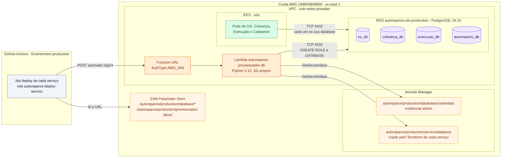
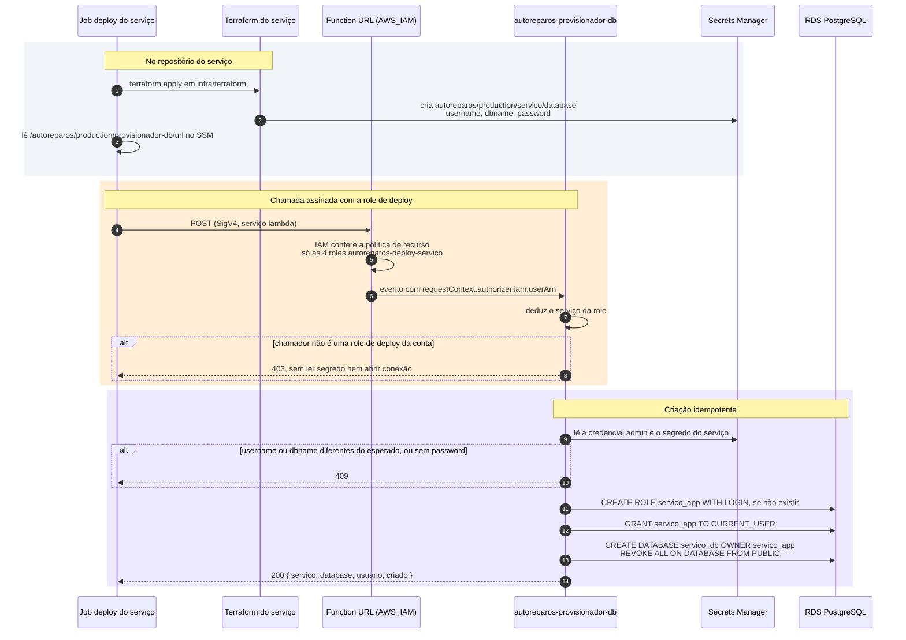
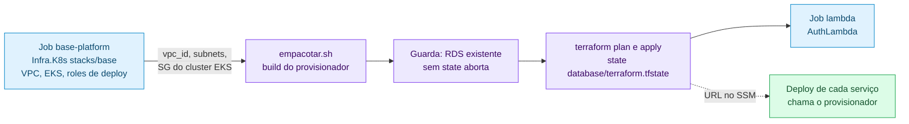

# AutoReparos.Infra.Database

> Plataforma de dados relacionais do AutoReparos: **uma instância RDS PostgreSQL 16** compartilhada, com **uma database e um usuário por microsserviço**, criados sob demanda pelo provisionador `autoreparos-provisionador-db`.

[](https://github.com/Grupo78-PosTech-15SOAT/AutoReparos.Infra.Database/actions/workflows/ci.yml)


| | |
|---|---|
| **Projeto** | AutoReparos — Sistema Integrado de Oficina Mecânica |
| **Fase** | Tech Challenge FIAP SOAT — Fase 4 (microsserviços, Saga e CI/CD), Grupo 78 |
| **Papel** | Repositório de plataforma: instância RDS, credencial admin, regras de rede e provisionador de databases |
| **Stack** | Terraform (provider AWS `>= 6.28, < 7.0`, `random`, `archive`), Amazon RDS PostgreSQL 16, Secrets Manager, SSM Parameter Store, AWS Lambda (Python 3.12 + `pg8000`) |
| **Repositório pai** | [Grupo78-PosTech-15SOAT/AutoReparos](https://github.com/Grupo78-PosTech-15SOAT/AutoReparos) |

---

## Sumário

1. [Visão geral e papel no ecossistema](#1-visão-geral-e-papel-no-ecossistema)
2. [Arquitetura](#2-arquitetura)
3. [Recursos provisionados](#3-recursos-provisionados)
4. [Provisionador de databases](#4-provisionador-de-databases)
5. [Estrutura do repositório](#5-estrutura-do-repositório)
6. [Pré-requisitos](#6-pré-requisitos)
7. [Como rodar e testar localmente](#7-como-rodar-e-testar-localmente)
8. [CI/CD e deploy](#8-cicd-e-deploy)
9. [Variáveis, outputs e parâmetros](#9-variáveis-outputs-e-parâmetros)
10. [Segredos](#10-segredos)
11. [Segurança e custo](#11-segurança-e-custo)
12. [Repositórios relacionados](#12-repositórios-relacionados)

---

## 1. Visão geral e papel no ecossistema

O enunciado da Fase 4 exige que cada microsserviço tenha **banco de dados próprio** e que **nenhum serviço acesse o banco de outro**, com pelo menos um banco relacional e um não relacional. O grupo decidiu (especificação, D-05 e D-54):

- **uma instância RDS PostgreSQL** para todos os serviços, para caber no orçamento da conta;
- **uma database e um usuário por serviço** (`<servico>_db` / `<servico>_app`), e o usuário é dono só da própria database. `CONNECT` público é revogado das databases criadas;
- a **credencial admin** do RDS fica só com a Lambda `autoreparos-provisionador-db`; o pipeline de cada serviço pede a própria database a ela, assinando com a role de deploy do serviço;
- o banco **não relacional** (DynamoDB, estado da Saga) não está aqui: é recurso exclusivo do [AutoReparos.OS](https://github.com/Grupo78-PosTech-15SOAT/AutoReparos.OS), criado pelo Terraform daquele repositório (D-04, D-42).

| Serviço | Database | Usuário | Observação |
|---|---|---|---|
| OS | `os_db` | `os_app` | criada pelo provisionador |
| Cobrança | `cobranca_db` | `cobranca_app` | criada pelo provisionador |
| Execução | `execucao_db` | `execucao_app` | criada pelo provisionador |
| Cadastros | `autoreparos_db` | `cadastros_app` | database inicial da instância (`db_name`); o provisionador só troca o dono para `cadastros_app` (D-34). Renomear exigiria recriar a instância |

O esquema de cada database é do serviço dono: as migrations EF Core rodam por um Job Helm `pre-upgrade` no chart de cada serviço (D-47, [ADR-004](https://github.com/Grupo78-PosTech-15SOAT/AutoReparos/blob/main/docs/architecture/ADR-004-migrations-por-job-pre-upgrade.md)).

---

## 2. Arquitetura

### 2.1 Rede e acesso



O security group do RDS (`autoreparos-rds-sg-production`) aceita a porta 5432 **só** de dois security groups: o do cluster EKS (passado pelo workflow do pai) e o do provisionador. Entrada por bloco CIDR é proibida por validação da variável `allowed_cidr_blocks`. A AuthLambda não está na lista: ela autentica o cliente pelo endpoint interno do Cadastros (D-11).

### 2.2 Provisionamento da database de um serviço



A senha de um usuário que já existe nunca é trocada, e os nomes vêm da role que assinou a chamada, nunca do conteúdo do segredo.

---

## 3. Recursos provisionados

Arquivos [`terraform/main.tf`](terraform/main.tf) e [`terraform/provisionador.tf`](terraform/provisionador.tf).

| Recurso | Nome em produção | Configuração |
|---|---|---|
| `aws_db_instance.postgres` | `autoreparos-rds-production` | PostgreSQL `16.15`, `db.t4g.micro`, 20 GiB `gp3` com autoscaling até 100 GiB, criptografado, `publicly_accessible = false`, Single-AZ, backup de 1 dia (janela 03:00–04:00 UTC), manutenção domingo 04:30–05:30 UTC, `deletion_protection = true`, snapshot final obrigatório, minor upgrade automático |
| `aws_db_subnet_group.rds` | `autoreparos-db-subnet-group-production` | Sub-redes privadas da VPC da plataforma |
| `aws_security_group.rds` | `autoreparos-rds-sg-production` | Entrada 5432 só dos SGs do EKS e do provisionador |
| `aws_db_parameter_group.pg16` | `autoreparos-pg16-params-production` | `log_connections`, `log_disconnections` e `log_min_duration_statement = 1000` ms |
| `random_password.master_password` | — | Senha admin de 24 caracteres quando `db_password` está vazia |
| `aws_secretsmanager_secret.db_credentials` | `autoreparos/production/database/credentials` | Credencial admin (`recovery_window_in_days = 0`) |
| `aws_ssm_parameter.*` | `/autoreparos/production/database/{endpoint,address,name,secret_arn}` | Parâmetros não secretos lidos pelos serviços |
| `aws_lambda_function.provisionador` | `autoreparos-provisionador-db` | Python 3.12, 128 MB, 30 s, nas sub-redes privadas |
| `aws_lambda_function_url.provisionador` | — | `authorization_type = AWS_IAM` |
| `aws_lambda_permission.provisionador_url` / `_invoke` | `InvokeFunctionUrl-<servico>` / `InvokeFunction-<servico>` | Só as roles `autoreparos-deploy-{os,cobranca,execucao,cadastros}`, e `InvokeFunction` só via Function URL |
| `aws_iam_role.provisionador` | `autoreparos-provisionador-db` | `AWSLambdaVPCAccessExecutionRole` e `secretsmanager:GetSecretValue` só na credencial admin e em `autoreparos/production/*/database-*` |
| `aws_security_group.provisionador` | `autoreparos-provisionador-db-sg` | Saída 5432 para o SG do RDS e 443 (Secrets Manager pelo NAT) |
| `aws_cloudwatch_log_group.provisionador` | `/aws/lambda/autoreparos-provisionador-db` | Retenção de 14 dias |
| `aws_ssm_parameter.provisionador_url` | `/autoreparos/production/provisionador-db/url` | URL lida pelo job de deploy de cada serviço |

**State remoto:** chave `database/terraform.tfstate`, lock na tabela `autoreparos-terraform-locks` (bucket e região chegam por `-backend-config`).

---

## 4. Provisionador de databases

Código: [`lambda/provisionador/provisionador.py`](lambda/provisionador/provisionador.py).

| Resposta | Quando |
|---|---|
| `200` | Database e usuário prontos. Corpo: `{"servico": "os", "database": "os_db", "usuario": "os_app", "criado": {"database": true, "usuario": true}}` (`false` quando já existiam) |
| `403` | O `userArn` não é `arn:aws:sts::<conta>:assumed-role/autoreparos-deploy-<servico>/...` de um dos 4 serviços na conta configurada |
| `405` | Método diferente de `POST` |
| `409` | Segredo do serviço ausente ou ilegível; `username`/`dbname` diferentes de `<servico>_app`/`<servico>_db`; segredo sem `password`; database do Cadastros inexistente |
| `500` | Falha inesperada (conexão, SQL); detalhe só no log |

Detalhes de implementação:

- identificadores e literais são citados por funções próprias (`CREATE ROLE` não aceita parâmetro ligado); bytes nulos são recusados;
- a conexão usa TLS; sem `DB_SSL_CA`, cifra sem validar o certificado (mesmo nível do `SSL Mode=Prefer` do segredo admin);
- `GRANT <usuario> TO CURRENT_USER` é necessário porque o admin do RDS não é superusuário e precisa assumir o papel para transferir a posse da database;
- variáveis de ambiente da função: `ADMIN_SECRET_ARN`, `AMBIENTE`, `DB_NAME_CADASTROS`, `CONTA_AWS` (e, opcional, `DB_SSL_CA`).

---

## 5. Estrutura do repositório

```text
AutoReparos.Infra.Database/
├── .github/workflows/ci.yml           # CI: terraform fmt, init -backend=false e validate
├── terraform/
│   ├── providers.tf                   # providers aws, random, archive; backend S3 parcial
│   ├── main.tf                        # RDS, subnet group, SG, parameter group, segredo admin, SSM
│   ├── provisionador.tf               # Lambda, Function URL, permissões, SG, role, log group, SSM
│   ├── variables.tf · outputs.tf
│   ├── terraform.tfvars.example
│   └── tests/provisionador.tftest.hcl # terraform test com mock_provider (sem AWS)
├── lambda/provisionador/
│   ├── provisionador.py               # handler da Function URL
│   ├── requirements.txt               # pg8000 1.31.5 e scramp < 1.5
│   ├── empacotar.sh                   # gera build/ para o archive_file do Terraform
│   └── tests/test_provisionador.py    # unittest com Postgres e Secrets Manager falsos
├── scripts/                           # DDL documental do esquema da Fase 3 (não é aplicado)
├── MODELAGEM_BANCO_DE_DADOS.md        # modelagem relacional da Fase 3 (histórico)
└── docker-compose.yml                 # PostgreSQL 16 + pgAdmin para uso local
```

`scripts/` e `MODELAGEM_BANCO_DE_DADOS.md` documentam o esquema do monólito da Fase 3, hoje herdado pelo Cadastros. Eles não são executados por nenhum pipeline; a fonte da verdade do esquema são as migrations EF Core de cada serviço.

---

## 6. Pré-requisitos

| Ferramenta | Versão | Para quê |
|---|---|---|
| Terraform | ≥ 1.7 (o CI e o pai usam 1.10.5) | validar, testar e aplicar `terraform/` |
| Python | 3.12 com `pip` | empacotar e testar o provisionador |
| AWS CLI v2 | — | só para operação manual na conta `198903849859` |
| Docker | opcional | PostgreSQL local |

---

## 7. Como rodar e testar localmente

### 7.1 PostgreSQL local

```bash
docker compose up -d     # PostgreSQL 16 em localhost:5432 e pgAdmin em http://localhost:5050
docker compose down
```

As credenciais locais têm padrões de desenvolvimento no [`docker-compose.yml`](docker-compose.yml) e podem ser trocadas por `POSTGRES_DB`, `POSTGRES_USER`, `DB_PASSWORD`, `PGADMIN_EMAIL` e `PGADMIN_PASSWORD`. Cada serviço também tem o próprio compose com a sua database.

### 7.2 Testes do provisionador (sem AWS)

```bash
# testes Python: 7 casos (database do próprio serviço, Cadastros, idempotência, 403 sem tocar no banco,
# OS não cria cobranca_db, CREATE DATABASE fora de transação, senha com aspas)
python3 -m unittest discover -s lambda/provisionador/tests -p test_provisionador.py

# testes do Terraform com mock_provider: 3 cenários
terraform -chdir=terraform init -backend=false
terraform -chdir=terraform test -filter=tests/provisionador.tftest.hcl
```

| Cenário do `terraform test` | O que prova |
|---|---|
| `lambda_na_vpc_com_acesso_ao_rds` | Lambda nas sub-redes privadas, SG próprio, entrada 5432 no RDS vinda dele e saída 5432 para o RDS |
| `function_url_aws_iam_so_para_as_roles_de_deploy` | Function URL `AWS_IAM`; invocação só pelas 4 roles de deploy e só via URL; URL publicada no SSM |
| `unica_role_com_a_credencial_admin` | Só a role do provisionador lê a credencial admin; nenhuma outra role com curinga ou política gerenciada de segredos |

Os dois conjuntos passaram em 17/11/2026 (7/7 e 3/3).

### 7.3 Validação e plano

```bash
lambda/provisionador/empacotar.sh                 # obrigatório antes de plan/apply (gera build/)
terraform -chdir=terraform fmt -check -recursive
terraform -chdir=terraform init -backend=false
terraform -chdir=terraform validate
```

Não rode `apply` local contra produção: o state é escrito só pelo workflow do pai.

---

## 8. CI/CD e deploy

### 8.1 CI deste repositório

[`ci.yml`](.github/workflows/ci.yml) roda em push e pull request para `main` e `develop` quando mudam `terraform/**` ou o próprio workflow: `terraform fmt -check -recursive`, `terraform init -backend=false` e `terraform validate`, sem credenciais AWS. Os testes do provisionador rodam pelos scripts de prova do pai (`scripts/specs/tf_test.sh`).

A `main` é protegida: exige pull request com 1 aprovação (regra também aplicada a administradores).

### 8.2 Deploy pelo repositório pai

Este repositório é **plataforma** e não aplica nada sozinho (D-13, D-45). O job `database` do workflow `Provision AWS` do pai faz o deploy:



| Workflow do pai | Entrada de confirmação | Efeito neste repositório |
|---|---|---|
| `Provision AWS` (`provision-aws.yml`) | `confirmation = CONFIRMAR-PROVISIONAMENTO` e `inventory_reviewed = true` | Job `database` (depois de `base-platform`): empacota o provisionador, define `TF_VAR_vpc_id`, `TF_VAR_private_subnet_ids` e `TF_VAR_allowed_security_group_ids = [SG do cluster EKS]`, faz `plan` e `apply` |
| `Teardown AWS` (`destroy-aws.yml`) | `confirmation = CONFIRMAR-DESTRUICAO`, `delete_database = true` e `database_confirmation = DELETE-RDS-DATA` | Desliga `deletion_protection` num plano que só pode atualizar recursos, depois `terraform destroy` com snapshot final `autoreparos-production-<run_id>-final`. Sem `delete_database`, o RDS e o segredo são mantidos |

Ordem obrigatória:

1. As roles `autoreparos-deploy-<servico>` precisam existir antes (stack `base` do [Infra.K8s](https://github.com/Grupo78-PosTech-15SOAT/AutoReparos.Infra.K8s)), porque as permissões da Lambda as citam por ARN.
2. Este stack é aplicado antes da AuthLambda e do gateway.
3. Cada serviço, no próprio pipeline, cria o segredo da sua database e chama o provisionador antes do `helm upgrade` (ver o README de cada serviço).

---

## 9. Variáveis, outputs e parâmetros

### Variáveis

| Variável | Tipo | Padrão | Descrição |
|---|---|---|---|
| `aws_region` | `string` | `us-east-1` | Região |
| `environment` | `string` | `production` | Sufixo dos nomes e dos caminhos de segredo e SSM |
| `vpc_id` | `string` | obrigatório | VPC do state de rede (validação: `vpc-`) |
| `private_subnet_ids` | `list(string)` | obrigatório | Ao menos 2 sub-redes privadas |
| `allowed_security_group_ids` | `list(string)` | obrigatório | SG do cluster EKS (ao menos 1, `sg-`) |
| `allowed_cidr_blocks` | `list(string)` | `[]` | Bloqueado por validação: só lista vazia |
| `db_name` | `string` | `autoreparos_db` | Database inicial (a do Cadastros) |
| `db_username` | `string` | `autoreparos_admin` | Usuário admin |
| `db_password` | `string` (sensível) | `""` | Vazio gera senha aleatória |
| `db_instance_class` | `string` | `db.t4g.micro` | Classe da instância |
| `db_allocated_storage` | `number` | `20` | GiB iniciais |
| `db_max_allocated_storage` | `number` | `100` | Limite do autoscaling de disco |
| `backup_retention_period` | `number` | `1` | Dias de backup |
| `multi_az` | `bool` | `false` | Alta disponibilidade |
| `deletion_protection` | `bool` | `true` | Proteção contra exclusão |
| `skip_final_snapshot` | `bool` | `false` | Snapshot final na destruição |
| `final_snapshot_identifier` | `string` | `autoreparos-rds-production-final` | Nome do snapshot final (o teardown passa um nome único) |
| `conta_aws_id` | `string` | `198903849859` | Conta das roles de deploy autorizadas (D-50) |

### Outputs

| Output | Descrição |
|---|---|
| `db_endpoint` · `db_address` · `db_port` · `db_name` | Conexão do RDS |
| `db_instance_id` | Identificador da instância |
| `db_security_group_id` | SG do RDS |
| `db_secret_arn` | ARN da credencial admin (lido pelo workflow do pai) |
| `provisionador_url` | Function URL do provisionador |

Credenciais nunca são outputs.

### Parâmetros SSM publicados

| Parâmetro | Conteúdo | Quem lê |
|---|---|---|
| `/autoreparos/production/database/endpoint` | `host:porta` | — |
| `/autoreparos/production/database/address` | host do RDS | Terraform de cada serviço, para montar o segredo da própria database |
| `/autoreparos/production/database/name` | `autoreparos_db` | — |
| `/autoreparos/production/database/secret_arn` | ARN da credencial admin | — |
| `/autoreparos/production/provisionador-db/url` | Function URL | Job de deploy de cada serviço |

As roles de deploy dos serviços só têm `ssm:GetParameter` nesses caminhos não secretos (política do stack `base` do Infra.K8s, D-53).

---

## 10. Segredos

Só nomes; nenhum valor fica no repositório.

| Segredo (Secrets Manager) | Chaves | Dono | Quem lê |
|---|---|---|---|
| `autoreparos/production/database/credentials` | `engine`, `host`, `port`, `dbname`, `username`, `password`, `connectionString` | Este repositório | Só a Lambda `autoreparos-provisionador-db` |
| `autoreparos/production/<servico>/database` | `username`, `dbname`, `host`, `port`, `password`, `connectionString` | Terraform de cada serviço | O provisionador (para criar o usuário) e o job de deploy do serviço, que copia a `connectionString` para um Secret do namespace |

No GitHub, este repositório não tem secrets. O workflow do pai usa a role da plataforma por OIDC (`AWS_ROLE_ARN`) e o backend (`TF_STATE_BUCKET`, `TF_LOCK_TABLE`, `AWS_REGION`), todos no Environment `production` do pai.

---

## 11. Segurança e custo

| Tema | Decisão |
|---|---|
| Isolamento entre serviços | Uma database e um usuário por serviço; `REVOKE ALL ... FROM PUBLIC`; nenhum serviço recebe credencial de outro |
| Credencial admin | Só a role do provisionador a lê (provado por `terraform test`); o pipeline de um serviço só consegue pedir a database dele (D-54, substitui o risco aceito na D-49) |
| Superfície de rede | Instância privada; SG sem CIDR; Function URL só com assinatura IAM; `403` antes de qualquer leitura de segredo |
| Dados | Disco criptografado; `deletion_protection`; snapshot final obrigatório no teardown |
| Auditoria | Logs de conexão e de consultas acima de 1 s no parameter group; logs do provisionador por 14 dias |
| Custo | `db.t4g.micro`, Single-AZ, backup de 1 dia; um RDS para todos os serviços em vez de um por serviço |

Limitações conhecidas: Single-AZ (sem failover automático) e `recovery_window_in_days = 0` no segredo admin (excluído na hora no teardown), escolhas de custo para o ambiente acadêmico.

---

## 12. Repositórios relacionados

| Repositório | Papel |
|---|---|
| [AutoReparos](https://github.com/Grupo78-PosTech-15SOAT/AutoReparos) | Pai: submódulos, especificação e workflows que aplicam este Terraform |
| [AutoReparos.Infra.K8s](https://github.com/Grupo78-PosTech-15SOAT/AutoReparos.Infra.K8s) | VPC, EKS, roles de deploy dos serviços e backend do Terraform |
| [AutoReparos.OS](https://github.com/Grupo78-PosTech-15SOAT/AutoReparos.OS) | Usa `os_db` e as tabelas DynamoDB da Saga |
| [AutoReparos.Cobranca](https://github.com/Grupo78-PosTech-15SOAT/AutoReparos.Cobranca) | Usa `cobranca_db` |
| [AutoReparos.Execucao](https://github.com/Grupo78-PosTech-15SOAT/AutoReparos.Execucao) | Usa `execucao_db` |
| [AutoReparos.Cadastros](https://github.com/Grupo78-PosTech-15SOAT/AutoReparos.Cadastros) | Usa `autoreparos_db` |
| [AutoReparos.AuthLambda](https://github.com/Grupo78-PosTech-15SOAT/AutoReparos.AuthLambda) | Autenticação do cliente; não acessa o banco |
| [AutoReparos.Web](https://github.com/Grupo78-PosTech-15SOAT/AutoReparos.Web) | Frontend Angular |

Documentação no pai: [spec de bancos de dados](https://github.com/Grupo78-PosTech-15SOAT/AutoReparos/blob/main/.specs/features/fase4/especificacao/microsservicos/fase4_spec_bancos_de_dados.md) · [ADR-005](https://github.com/Grupo78-PosTech-15SOAT/AutoReparos/blob/main/docs/architecture/ADR-005-deploy-independente-por-microsservico.md) · [arquitetura e justificativa](https://github.com/Grupo78-PosTech-15SOAT/AutoReparos/blob/main/docs/entrega/fase4/arquitetura_e_justificativa.md) · [índice de decisões](https://github.com/Grupo78-PosTech-15SOAT/AutoReparos/blob/main/.specs/features/fase4/especificacao/index.md).
